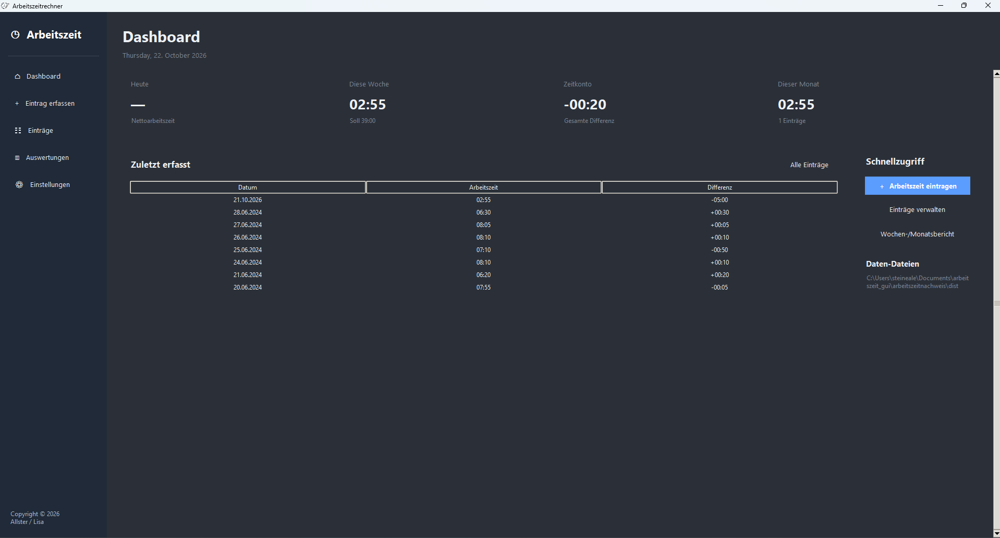
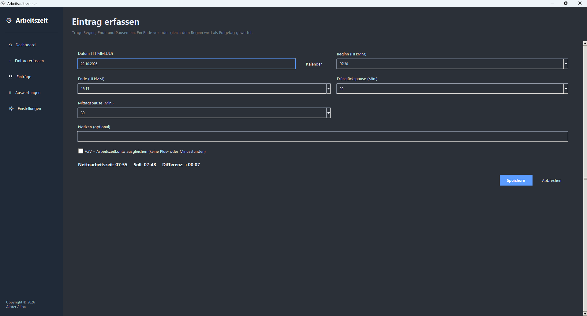
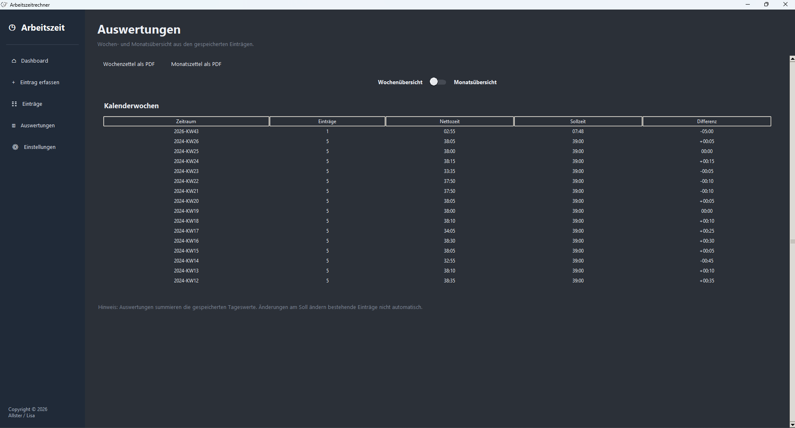
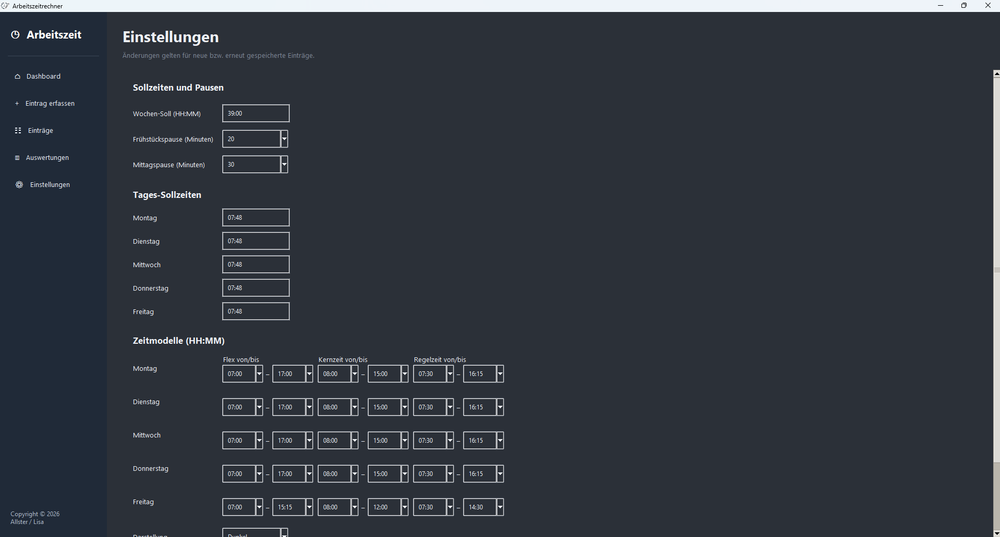

# Arbeitszeit-Rechner

Ein grafischer Arbeitszeit-Rechner in Python zur Erfassung, Verwaltung und Auswertung von Arbeitszeiten.

Die Anwendung bietet eine übersichtliche Benutzeroberfläche, automatische Arbeitszeitberechnungen sowie verschiedene Möglichkeiten zur Auswertung und Konfiguration.

Das Projekt wird aktiv weiterentwickelt.

## Screenshots

### Dashboard

Übersicht über die erfassten Arbeitszeiten und die wichtigsten Kennzahlen.



### Arbeitszeit erfassen

Arbeitszeiten eintragen und die berechneten Werte automatisch ermitteln lassen.



### Auswertungen

Gespeicherte Arbeitszeiten übersichtlich auswerten und zusammenfassen.



### Einstellungen

Die Anwendung an die eigenen Arbeitszeiten und Darstellungspräferenzen anpassen.



## Funktionen

- **Grafische Benutzeroberfläche:** Bedienung über eine GUI statt über die Kommandozeile.
- **Dashboard:** Übersicht über wichtige Arbeitszeitdaten und Kennzahlen.
- **Arbeitszeiterfassung:** Arbeitsbeginn, Arbeitsende, Pausen und Datum verwalten.
- **Automatische Berechnungen:** Nettoarbeitszeit und Differenz zur Sollarbeitszeit berechnen.
- **Übernachtzeiten:** Arbeitszeiten über Mitternacht berücksichtigen.
- **Kalender:** Datum über eine integrierte Kalenderansicht auswählen.
- **Eintragsverwaltung:** Gespeicherte Arbeitszeiten anzeigen und verwalten.
- **Auswertungen:** Arbeitszeiten für unterschiedliche Zeiträume zusammenfassen.
- **PDF-Export:** Wochenzettel exportieren.
- **Einstellungen:** Sollarbeitszeit, Pausen und Darstellung konfigurieren.
- **Dauerhafte Speicherung:** Arbeitszeitdaten und Einstellungen über Programmstarts hinweg erhalten.

## Installation und Start

### Windows-Anwendung

Die bereitgestellte `Arbeitszeitnachweis.exe` kann per Doppelklick gestartet werden. Für die vorkompilierte Anwendung ist keine separate Python-Installation erforderlich.


### Start aus dem Quellcode

Voraussetzung ist eine installierte Python-Version, mit der das Projekt kompatibel ist.

1. Repository herunterladen oder klonen.
2. Das Projektverzeichnis öffnen.
3. Die grafische Benutzeroberfläche starten:

```powershell
python rechner-gui.py
```

Für den Start werden weder eine virtuelle Umgebung noch eine `requirements.txt` vorausgesetzt.

Ob bei einer neuen Python-Installation zusätzliche Pakete erforderlich sind, hängt von den verwendeten Modulen ab.

## Projektstruktur

| Datei | Beschreibung |
| --- | --- |
| `rechner-gui.py` | Grafische Benutzeroberfläche |
| `arbeitszeit_core.py` | Gemeinsame Daten-, Berechnungs- und Speicherlogik |
| `arbeitszeit_einstellungen.json` | Einstellungen der Anwendung, sofern angelegt |
| `icon.png` | Anwendungssymbol |
| `icon.ico` | Windows-Anwendungssymbol |
| `Arbeitszeitnachweis.exe` | Vorkompilierte Windows-Anwendung |

## Technologie

- **Python** – Programmiersprache
- **Tkinter / ttk** – grafische Benutzeroberfläche
- **JSON** – Speicherung von Einstellungen, soweit im Projekt verwendet
- **PyInstaller** – Erstellung der Windows-Anwendung, sofern für den Build eingesetzt

## Aktueller Entwicklungsstand

Die grafische Benutzeroberfläche ist implementiert und bildet den zentralen Bestandteil der Anwendung. Die frühere Kommandozeilenoberfläche wird nicht mehr verwendet.

Die aktuelle Entwicklung konzentriert sich auf die Verbesserung der Benutzeroberfläche, die übersichtliche Darstellung der Tabellen und Auswertungen sowie eine konsistente Darstellung im hellen und dunklen Modus.

## Datensicherung

Arbeitszeitdaten und Einstellungen sollten regelmäßig gesichert werden. Vor Updates oder größeren Änderungen empfiehlt sich eine zusätzliche Sicherung der vorhandenen Daten.

## Repository

[Arbeitszeit-Rechner auf GitHub](https://github.com/allstergamer/Arbeitszeit-Rechner)

---

Entwickelt von [allstergamer](https://github.com/allstergamer).
